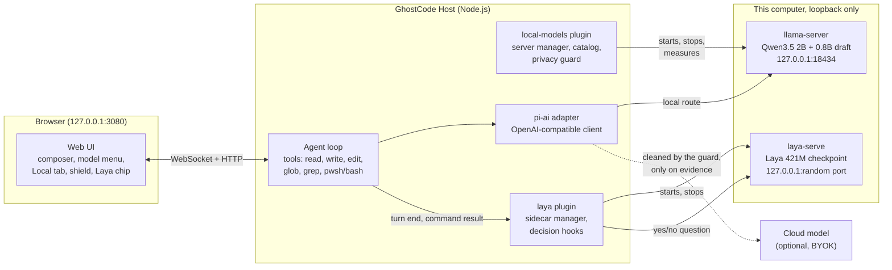
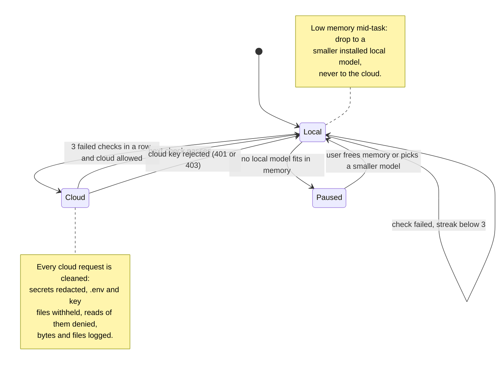
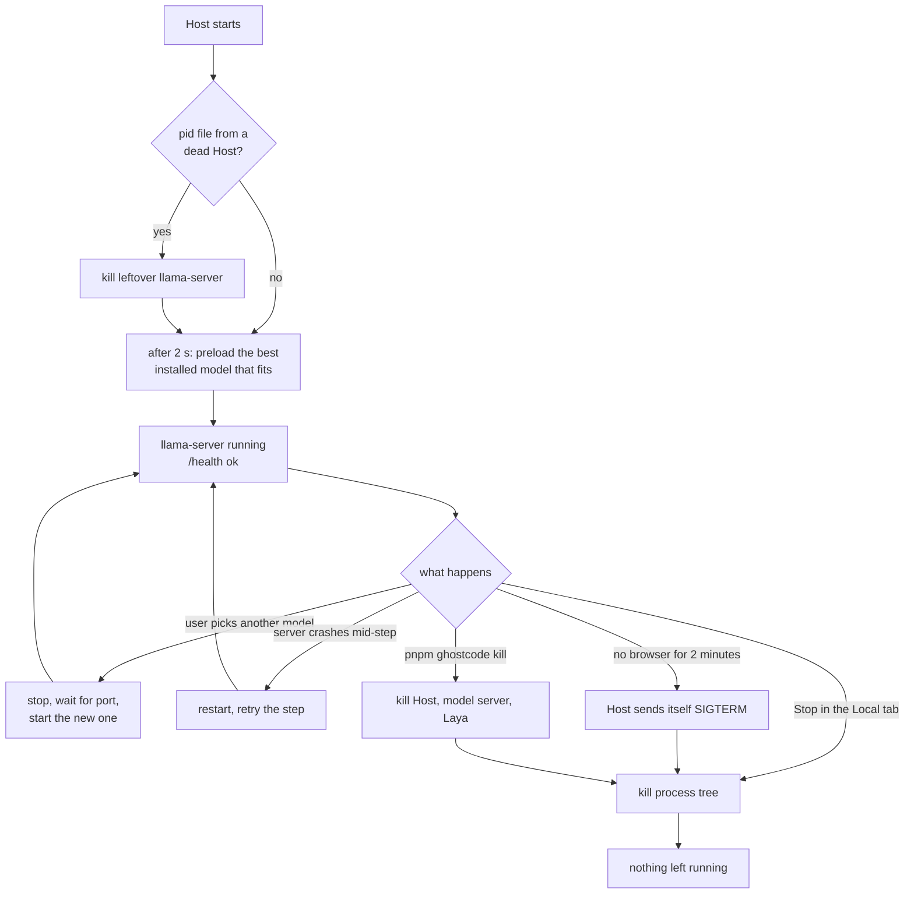

# GhostCode architecture

GhostCode is an offline-first coding agent. It runs an open model on the user's own computer, checks its own work with a second local model (Laya), and only sends anything to a cloud model after cleaning it and after evidence shows the local answer failed.

It is a fork of [DeepSeek Harness](https://github.com/deepseek-ai/deepseek-harness) (MIT). The harness is "everything is a plugin": GhostCode's features are plugins on the harness hooks, not edits to the agent loop.

## The pieces



| Part | Where | What it does |
|---|---|---|
| Agent loop | `harness/packages/core/agent-loop` | Runs turns and steps, calls tools, streams model output |
| Local models | `harness/packages/extensions/local-models` | Downloads llama.cpp and pinned GGUF models, runs one `llama-server`, the privacy guard |
| Laya | `harness/packages/extensions/laya` | Installs Laya, runs `laya-serve`, asks it whether a task is done and whether a command succeeded |
| Model adapter | `harness/packages/llm/llm-pi-ai` | One OpenAI-compatible client for local and cloud routes |
| Local tab | `harness/packages/client/ui-model-selection` | System scan, recommended models, one-click install with progress |
| Shield and Laya chip | `harness/packages/client/ui-laya` | Shows the hurdle evidence and Laya's latest decision |
| Kill switch | `harness/apps/cli/src/kill.ts` | `pnpm ghostcode kill` stops the Host, the model server and Laya |

## One request, end to end

```mermaid
sequenceDiagram
    participant U as User
    participant L as Agent loop
    participant G as Privacy guard
    participant M as llama-server (local)
    participant C as Cloud model
    participant Y as Laya

    U->>L: prompt
    L->>G: agent/pre-step
    G->>G: check free RAM, start or switch local model
    L->>G: llm/stream (request)
    alt route is local
        G->>M: short prompt + 9 slim tools
        M-->>L: streamed reply and tool calls
    else route is cloud
        G->>G: redact secrets, withhold .env results, log bytes and files
        G->>C: cleaned request
        C-->>L: streamed reply and tool calls
    end
    L->>L: run tool (write, pwsh, ...)
    L->>G: tools/post-execute
    G->>G: judge exit code and output
    L->>Y: did this command succeed?
    Y-->>L: probability, about 0.3 s
    L->>Y: agent/turn-stopping: is the task done?
    Y-->>L: probability; below 0.5 asks the model to verify
    L-->>U: final reply
```

## Never leak, verify before escalating

The hurdle is handled by the guard in `local-models/src/guard.ts`, `egress.ts` and the hooks in `local-models/src/index.ts`. See [HURDLE.md](HURDLE.md) for the demo script.



| Hint | Rule | Hook |
|---|---|---|
| 1. What may leave the machine | Cloud requests are redacted; tool results from secret files are withheld; reading secret files is denied while a cloud model is active; privacy mode blocks every cloud request | `llm/stream`, `tools/pre-execute` |
| 2. Know the local answer was bad | A command fails on a non-zero exit code or failure output; Laya breaks ties only when there is no exit code; escalation after 3 failures in a row; back to local on the next pass | `tools/post-execute` |
| 3. Resources run out mid-task | Before each step: weights may use 67.5% of free RAM; if the model no longer fits, switch to a smaller installed local model; a crashed server is restarted and the step retried; otherwise pause with a message | `agent/pre-step`, `agent/request-error` |

## Local model lifecycle



Process ownership:

- The model server's pid file records both pids: the server and the Host that started it. A second GhostCode on the same home leaves a live Host's server alone.
- Every child is killed as a process tree (`taskkill /T` on Windows), because a venv `python.exe` and `llama-server.exe` can start further processes.
- A Host that exits without cleanup still kills its children from a `process.on('exit')` handler.

## Speed: why a 2B model answers in seconds

| Measure | Value | How |
|---|---|---|
| Generation | 27 to 30 tokens/s | Qwen3.5 2B Q4_K_M on Intel Arc (Vulkan), with Qwen3.5 0.8B drafting tokens (23 tokens/s without) |
| Prompt for local steps | about 2.2K tokens | A 23-line local prompt and 9 slim tools, down from 9.7K |
| First prompt read | 4.4 s | 2,206 tokens at about 500 tokens/s |
| Follow-up prompt read | 0.9 s | The server's prompt cache reuses the shared prefix |
| Context window | 204,800 tokens | Qwen3.5's native window is 262K; the server opens 200K |
| Model start | about 20 s | Preloaded 2 s after the Host starts, so the first message does not wait |

Measured on an Intel Core Ultra 5 125H laptop with 16 GB RAM and Intel Arc graphics.

## Laya

Laya is a 421M-parameter decision model ([convaiinnovations/laya](https://huggingface.co/convaiinnovations/laya), Apache 2.0). It does not generate text; it answers one yes/no question in one forward pass.

GhostCode asks it two things:

- After a shell command: "Did this command succeed without errors?" Below 0.3 the model is told the command looks failed.
- When a turn is about to stop: "Is the user's request fully done?" Below 0.5 the model is asked to check its work once more.

Every decision is shown next to the brain button and appended to `~/.ghostcode/laya/decisions.jsonl`. The exit code always wins over Laya; Laya only decides when the output carries no exit code. Measured accuracy is in [BENCHMARK.md](BENCHMARK.md).

## Files on disk

| Path under `~/.ghostcode` | Contents |
|---|---|
| `local-models/bin/` | Pinned llama.cpp build |
| `local-models/models/` | GGUF files, each checked against its SHA-256 |
| `local-models/slots/` | Saved prompt cache per model |
| `local-models/measured.json` | Tokens per second measured on this machine |
| `local-models/egress.jsonl` | Every cloud request, block, escalation and recovery |
| `local-models/guard.json` | Privacy mode and escalation target |
| `local-models/llama-server.log` | Model server output |
| `laya/.venv/`, `laya/model/` | Laya packages and checkpoint |
| `laya/decisions.jsonl` | Every Laya decision |

## Settings

| Variable | Default | Effect |
|---|---|---|
| `GHOSTCODE_HOME` | `~/.ghostcode` | Home folder for sessions, models and logs |
| `GHOSTCODE_LOCAL_PORT` | `18434` | Port of the local model server |
| `GHOSTCODE_IDLE_EXIT_SECONDS` | `120` | Stop everything after this long with no browser; `0` turns it off |
| `GHOSTCODE_AUTO_CONTINUE` | `3` | Times per turn a reply cut off at the output limit continues on its own; `0` turns it off |
| `GHOSTCODE_LLAMA_BACKEND` | (auto) | `cpu` forces the CPU build of llama.cpp |
| `DSH_PERMISSION_MODE` | `danger-full-access` | `workspace-write` or `read-only` turns the Windows sandbox on |
